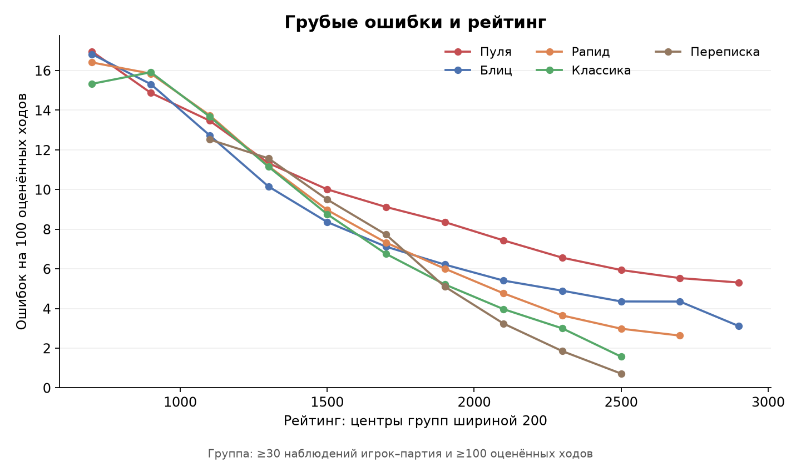
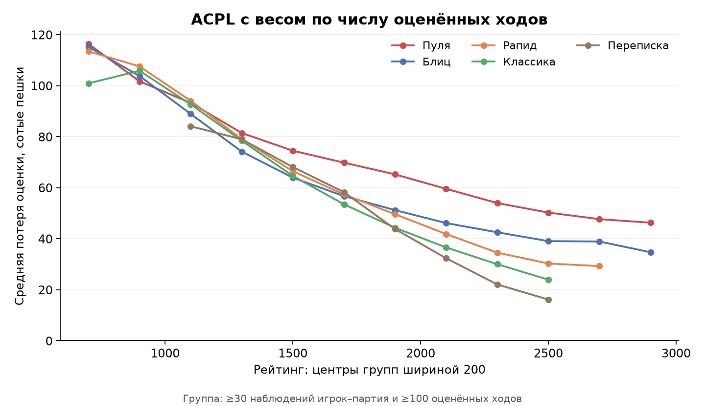
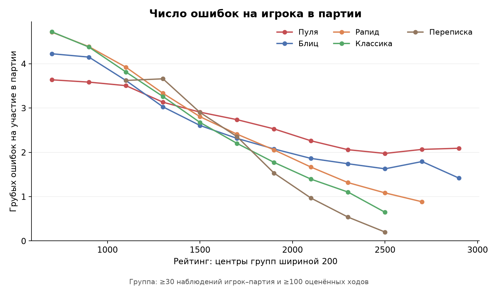
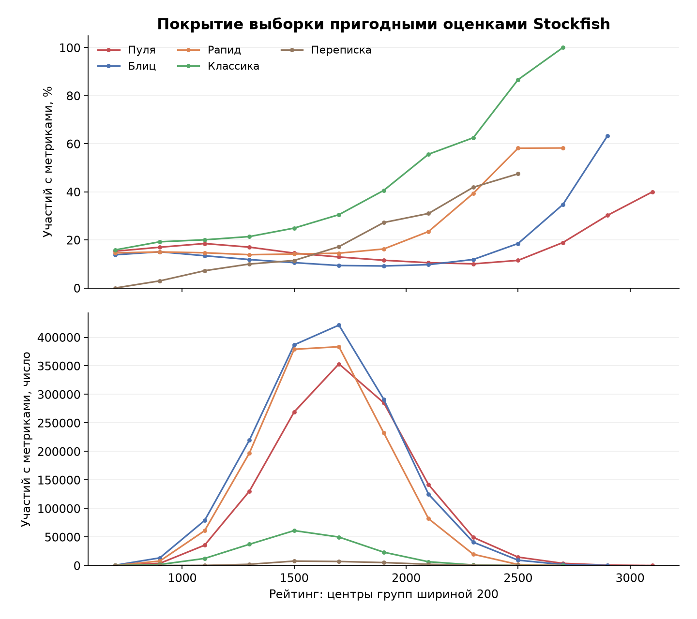

# Задача 4 — ошибки, ACPL и рейтинг

## Данные и метод

Входные файлы: `games_2013-01.csv`, `games_2014-01.csv`, `games_2015-01.csv`, `games_2016-01.csv`, `games_2017-01.csv`.
Классификация контроля: base_sec + 40 × inc_sec; единые современные границы Lichess.
Выбранные контроли: Ультрапуля, Пуля, Блиц, Рапид, Классика, Переписка. Анализируются завершённые партии. Повторы game_id удалены между всеми файлами; сохранена первая завершённая запись.

Месяц определяется по `utc_date`, а не имени дампа: в месячном файле могут встречаться партии с датой соседнего месяца.

## Качество данных

| Показатель | Число |
| --- | --- |
| Прочитано строк | 17767234 |
| Исключено строк без game_id | 0 |
| Исключено незавершённых/неизвестных результатов | 1558 |
| Исключено повторов game_id (среди завершённых) | 0 |
| Уникальных завершённых партий | 17765676 |
| Расхождений метки speed и расчёта по времени | 4526783 |
| Партий без корректного контроля времени | 0 |
| Исключено вне выбранных контролей | 0 |
| Партий в анализе | 17765676 |
| Партий в анализе с неизвестной датой | 0 |
| Партий с отсутствующей/некорректной длиной | 0 |
| Партий с отсутствующим/некорректным рейтингом белых | 148 |
| Партий с отсутствующим/некорректным рейтингом чёрных | 218 |
| Партий с has_eval = 1 | 2230089 |
| Наблюдений с has_eval = 1, но непригодными метриками | 3 |
| Наблюдений с метриками, но без корректного рейтинга | 0 |
| Наблюдений игрок–партия с пригодными метриками и рейтингом | 4460175 |

## Перекодировка контролей времени

Контроль определяется по современным границам Lichess, а не по метке из PGN. В ранних дампах метки `rapid` нет, и партии с оценочной длительностью 8–25 минут на игрока помечены там как `classical`; после перекодировки они попадают в рапид. Метка PGN сохраняется только для переписки (`correspondence`). Ниже — все расхождения метки и расчёта в этих данных.

| Метка в PGN | Контроль по времени | Партий | % от метки |
| --- | --- | --- | --- |
| Классика | Рапид | 4526783 | 92.594 |

Полная таблица переходов — `speed_relabel.csv`. Для анализа по исходным меткам запустите скрипт с `--speed-source event`.

## Определения

- Единица наблюдения — игрок в партии: белые и чёрные учитываются отдельно со своим рейтингом.
- Грубая ошибка — потеря ≥200 сотых пешки по принятому парсером определению. Используются готовые `*_blunders`; новые оценки движком не рассчитываются.
- Основная частота = `100 × sum(blunders) / sum(evaluated)`. Нельзя делить на все ходы партии или заменять отсутствующие оценки нулём.
- ACPL по ходам = `sum(acpl × evaluated) / sum(evaluated)`. Это взвешенное среднее; исходные ACPL округлены парсером до 0.1, поэтому результат приближённый.
- Дополнительно сохранены среднее число ошибок на участие в партии, средний ACPL по участиям и доля участий хотя бы с одной грубой ошибкой.
- Рейтинговые группы: [нижняя граница, нижняя + 200). Графики основных метрик показывают группы с ≥30 участиями и ≥100 оценёнными ходами. CSV содержит и меньшие группы.

## Сводка по рейтингам, все выбранные контроли

Объединённая таблица описывает состав выборки. Для сравнения рейтингов используйте также разрез по контролям и месяцам.

| Рейтинг от | Рейтинг до, не включая | Участий | Оценённых ходов | Грубых ошибок | Ошибок на 100 ходов | ACPL по ходам |
| --- | --- | --- | --- | --- | --- | --- |
| 600 | 800 | 719 | 18516 | 3084 | 16.656 | 114.147 |
| 800 | 1000 | 26655 | 716237 | 110699 | 15.456 | 104.811 |
| 1000 | 1200 | 188026 | 5258940 | 697339 | 13.26 | 91.644 |
| 1200 | 1400 | 586329 | 17172952 | 1858250 | 10.821 | 77.646 |
| 1400 | 1600 | 1103884 | 33834848 | 3039416 | 8.983 | 67.336 |
| 1600 | 1800 | 1215200 | 38771565 | 2993194 | 7.72 | 60.389 |
| 1800 | 2000 | 837963 | 27277020 | 1853907 | 6.797 | 54.939 |
| 2000 | 2200 | 357768 | 11788238 | 701479 | 5.951 | 49.746 |
| 2200 | 2400 | 111286 | 3760319 | 199885 | 5.316 | 45.551 |
| 2400 | 2600 | 25946 | 906769 | 46195 | 5.094 | 44.387 |
| 2600 | 2800 | 5497 | 211412 | 10828 | 5.122 | 44.678 |
| 2800 | 3000 | 888 | 36082 | 1736 | 4.811 | 43.663 |
| 3000 | 3200 | 14 | 562 | 26 | 4.626 | 45.172 |

## Выводы по этой выборке

- Пригодных участий: 4 460 175 из 35 530 986 с известным рейтингом (12.55%).
- На 139 753 460 оценённых ходов приходится 11 516 038 грубых ошибок: 8.24 на 100 ходов; ACPL по ходам — 63.11.
- Ультрапуля: меньше двух групп достигают порогов; для описания связи рейтинга и ошибок данных недостаточно.
- Пуля: в нижней доступной группе [600, 800) — 16.96 ошибки на 100 ходов; в верхней [2800, 3000) — 5.31. Это сравнение крайних пригодных групп, а не доказательство монотонной зависимости.
- Блиц: в нижней доступной группе [600, 800) — 16.82 ошибки на 100 ходов; в верхней [2800, 3000) — 3.11. Это сравнение крайних пригодных групп, а не доказательство монотонной зависимости.
- Рапид: в нижней доступной группе [600, 800) — 16.41 ошибки на 100 ходов; в верхней [2600, 2800) — 2.63. Это сравнение крайних пригодных групп, а не доказательство монотонной зависимости.
- Классика: в нижней доступной группе [600, 800) — 15.33 ошибки на 100 ходов; в верхней [2400, 2600) — 1.57. Это сравнение крайних пригодных групп, а не доказательство монотонной зависимости.
- Переписка: в нижней доступной группе [1000, 1200) — 12.52 ошибки на 100 ходов; в верхней [2400, 2600) — 0.71. Это сравнение крайних пригодных групп, а не доказательство монотонной зависимости.

## Ограничения

- Проанализированные Stockfish партии — отобранная часть базы. График покрытия показывает различия отбора по рейтингу; результаты нельзя автоматически переносить на все партии.
- Оценки обрезаны парсером до ±1000 cp; мат заменён на ±1000. Первый ход белых и ходы без двух соседних оценок не учитываются. Это учебная метрика проекта, она не обязана совпадать с метками ошибок на сайте Lichess.
- В выборку метрик входит участие с `has_eval=1`, корректным рейтингом, конечным ACPL от 0 до 2000, целыми `evaluated>0` и `0≤blunders≤evaluated`. Количество оценённых ходов не может превышать доступное по `n_plies`.
- Частота на оценённый ход — основная метрика. Число ошибок на партию зависит от её длины и полноты оценок; считать его самостоятельной мерой силы игрока нельзя.
- Рейтинги относятся к разным пулам и периодам; единая классификация времени не пересчитывает рейтинги. Контроли и месяцы сохранены раздельно для проверки смешения выборок.
- Идентификаторов игроков в CSV нет: участия повторных игроков не независимы. Пороги на графиках — фильтр малых групп, не проверка статистической значимости. Причинные выводы и доверительные интервалы по независимым ходам не строятся.

## Графики

## Таблицы

- `blunders_by_rating.csv`: объединённые рейтинговые группы.
- `blunders_by_speed_rating.csv`: основные сравнения внутри контролей.
- `blunders_by_month_speed_rating.csv`: контроль периода и состава выборки.
- `blunders_by_color_rating.csv`: белые и чёрные раздельно внутри контроля.
- `analysis_coverage.csv`, `coverage_by_month.csv`: доля пригодных участий среди всех с известным рейтингом.
- `speed_relabel.csv`: исходная метка контроля из PGN → контроль по времени.
- `run_metadata.json`: входы, параметры, версии библиотек и качество данных.
