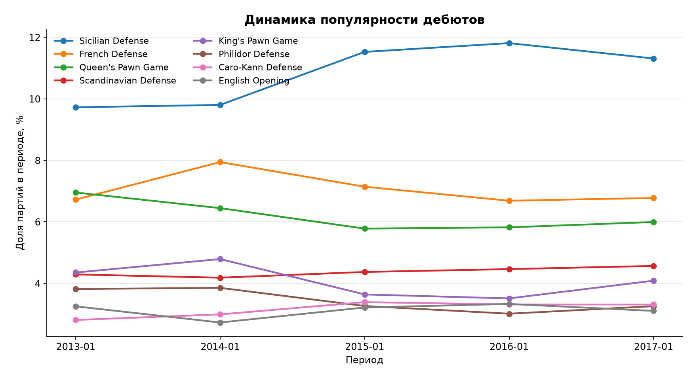
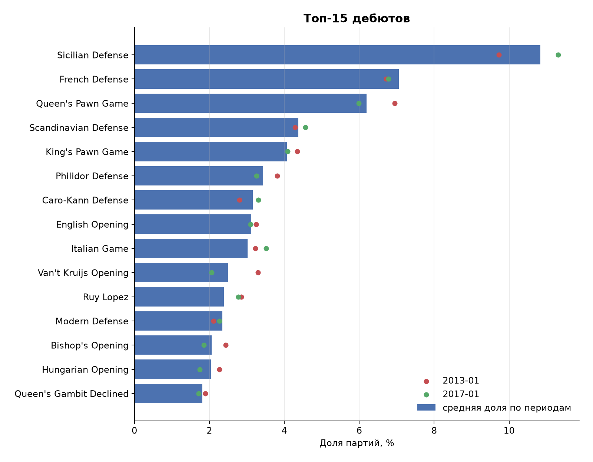
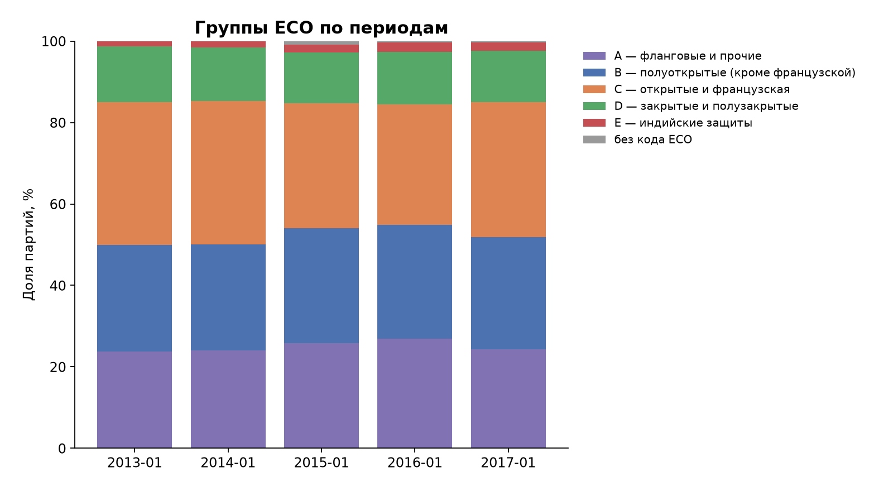
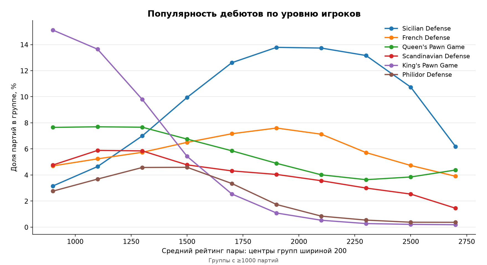

# Задача 1 — популярность дебютов и её динамика

## Данные и метод

Входные файлы: `games_2013-01.csv`, `games_2014-01.csv`, `games_2015-01.csv`, `games_2016-01.csv`, `games_2017-01.csv`.
Классификация контроля: base_sec + 40 × inc_sec; единые современные границы Lichess.
Выбранные контроли: Ультрапуля, Пуля, Блиц, Рапид, Классика, Переписка. Анализируются завершённые партии. Повторы game_id удалены между всеми файлами; сохранена первая завершённая запись.

Месяц определяется по `utc_date`, а не имени дампа: в месячном файле могут встречаться партии с датой соседнего месяца.

## Качество данных

| Показатель | Число |
| --- | --- |
| Прочитано строк | 17767234 |
| Исключено строк без game_id | 0 |
| Исключено незавершённых/неизвестных результатов | 1558 |
| Исключено повторов game_id (среди завершённых) | 0 |
| Уникальных завершённых партий | 17765676 |
| Расхождений метки speed и расчёта по времени | 4526783 |
| Партий без корректного контроля времени | 0 |
| Исключено вне выбранных контролей | 0 |
| Партий в анализе | 17765676 |
| Партий в анализе с неизвестной датой | 0 |
| Партий с отсутствующей/некорректной длиной | 0 |
| Партий с отсутствующим/некорректным рейтингом белых | 148 |
| Партий с отсутствующим/некорректным рейтингом чёрных | 218 |
| Партий с has_eval = 1 | 2230089 |
| Партий в периодах меньше порога (пограничные даты) | 18054 |
| Периодов в анализе | 5 |

## Определения

- Дебют — семейство из тега `Opening`: часть до «:» и «,», без номера «#N» (`Sicilian Defense: Najdorf Variation` → `Sicilian Defense`).
- Доля — доля партий периода. Период — месяц по `utc_date`. Месяцы, где партии есть меньше чем за 20 дней или их меньше 1000, исключены: это пограничные партии соседнего месяца, например 31 декабря в январском дампе (18054 партий).
- Топ ранжируется по средней доле по периодам: каждый период весит одинаково, поэтому самый большой месяц не определяет рейтинг дебютов.

## Топ-15 дебютов

| # | Дебют | Партий | Средняя доля, % | 2013-01, % | 2014-01, % | 2015-01, % | 2016-01, % | 2017-01, % | Изменение, п.п. |
| --- | --- | --- | --- | --- | --- | --- | --- | --- | --- |
| 1 | Sicilian Defense | 2022084 | 10.835 | 9.724 | 9.801 | 11.525 | 11.811 | 11.312 | 1.588 |
| 2 | French Defense | 1211582 | 7.053 | 6.721 | 7.942 | 7.14 | 6.684 | 6.775 | 0.053 |
| 3 | Queen's Pawn Game | 1056297 | 6.197 | 6.951 | 6.444 | 5.778 | 5.819 | 5.992 | -0.96 |
| 4 | Scandinavian Defense | 799067 | 4.372 | 4.287 | 4.181 | 4.367 | 4.46 | 4.564 | 0.276 |
| 5 | King's Pawn Game | 695889 | 4.073 | 4.349 | 4.787 | 3.636 | 3.507 | 4.084 | -0.265 |
| 6 | Philidor Defense | 570835 | 3.438 | 3.814 | 3.851 | 3.26 | 3.01 | 3.254 | -0.559 |
| 7 | Caro-Kann Defense | 585590 | 3.16 | 2.806 | 2.987 | 3.386 | 3.311 | 3.308 | 0.502 |
| 8 | English Opening | 560305 | 3.123 | 3.249 | 2.724 | 3.212 | 3.327 | 3.101 | -0.149 |
| 9 | Italian Game | 569326 | 3.02 | 3.23 | 2.965 | 2.658 | 2.738 | 3.511 | 0.28 |
| 10 | Van't Kruijs Opening | 378918 | 2.495 | 3.293 | 2.658 | 2.32 | 2.145 | 2.057 | -1.235 |
| 11 | Ruy Lopez | 449253 | 2.389 | 2.852 | 1.983 | 2.156 | 2.183 | 2.772 | -0.08 |
| 12 | Modern Defense | 416286 | 2.35 | 2.108 | 2.527 | 2.354 | 2.492 | 2.27 | 0.162 |
| 13 | Bishop's Opening | 322167 | 2.065 | 2.441 | 2.63 | 1.8 | 1.596 | 1.855 | -0.587 |
| 14 | Hungarian Opening | 330039 | 2.04 | 2.272 | 2.036 | 2.157 | 1.995 | 1.741 | -0.531 |
| 15 | Queen's Gambit Declined | 313448 | 1.817 | 1.897 | 1.869 | 1.73 | 1.873 | 1.715 | -0.182 |

## Группы ECO по периодам

Код ECO от названий не зависит, поэтому это проверка, что динамика семейств не объясняется переименованиями в разных дампах.

| Группа ECO | 2013-01, % | 2014-01, % | 2015-01, % | 2016-01, % | 2017-01, % |
| --- | --- | --- | --- | --- | --- |
| A — фланговые и прочие | 23.772 | 24.071 | 25.764 | 26.904 | 24.266 |
| B — полуоткрытые (кроме французской) | 26.1 | 26.041 | 28.295 | 27.969 | 27.595 |
| C — открытые и французская | 35.095 | 35.155 | 30.736 | 29.538 | 33.179 |
| D — закрытые и полузакрытые | 13.788 | 13.199 | 12.461 | 13.003 | 12.614 |
| E — индийские защиты | 1.245 | 1.516 | 1.827 | 2.283 | 2.019 |
| без кода ECO | 0 | 0.019 | 0.917 | 0.304 | 0.327 |

## Выводы по этой выборке

- Самый популярный дебют: Sicilian Defense — в среднем 10.83% партий периода.
- Пять самых популярных семейств вместе дают в среднем 32.53% партий.
- Сильнее всего выросла доля Sicilian Defense: 9.72% → 11.31% (+1.59 п.п., 2013-01 → 2017-01).
- Сильнее всего упала доля Owen Defense: 2.71% → 1.18% (-1.54 п.п.).
  Учитываются семейства со средней долей не меньше 0,5%.
- В топ-15 у 12 дебютов место в первом и последнем периодах различается.

### Лидер по контролям времени

| Контроль | Партий | Самый частый дебют | Доля, % |
| --- | --- | --- | --- |
| Пуля | 4997669 | Sicilian Defense | 9.462 |
| Блиц | 7748356 | Sicilian Defense | 13.174 |
| Рапид | 4515414 | Sicilian Defense | 10.664 |
| Классика | 362009 | Sicilian Defense | 9.573 |
| Переписка | 78918 | Sicilian Defense | 8.873 |

## Ограничения

- Доли описывают выбор игроков Lichess в эти периоды, а не «силу» дебюта; состав игроков от года к году меняется вместе с ростом сайта.
- Названия дебютов берутся из PGN каждого дампа. Если Lichess переименовывал варианты, семейство может «перетекать»; таблица ECO выше служит проверкой.
- Различия долей на таком объёме почти всегда статистически заметны; важен их размер в процентных пунктах, а не сам факт отличия.

## Графики

## Таблицы

- `opening_summary.csv`: все семейства — средняя доля, доля в каждом периоде, изменение.
- `opening_share_by_period.csv`: партии и доли семейств по периодам (длинный формат).
- `eco_share_by_period.csv`: то же для букв ECO.
- `opening_share_by_speed.csv`, `opening_share_by_rating.csv`: доли внутри контроля времени и внутри группы среднего рейтинга пары.
- `run_metadata.json`: входы, параметры, версии библиотек и качество данных.
