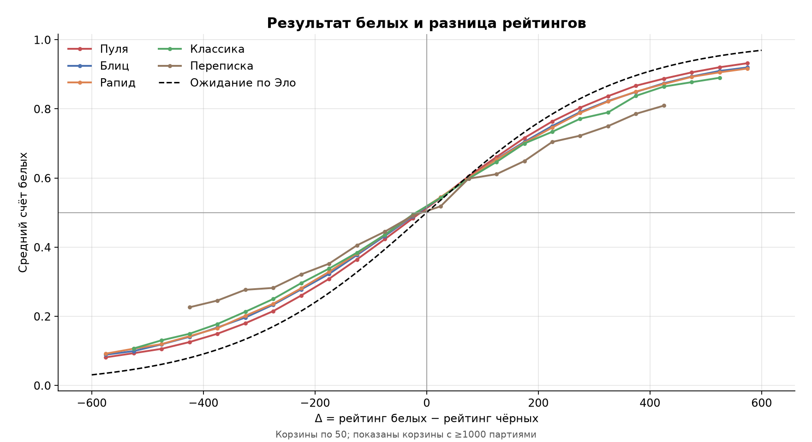
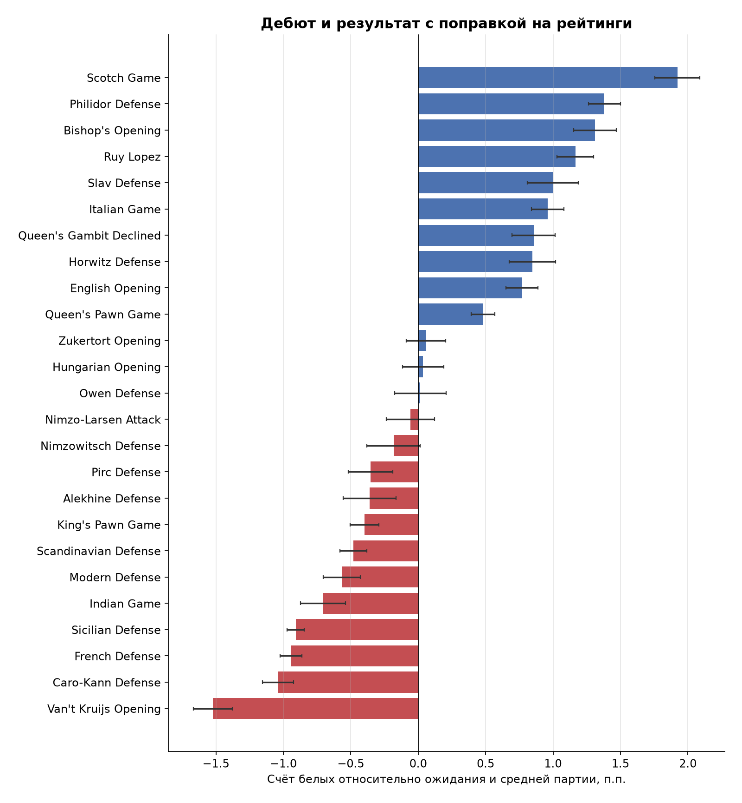
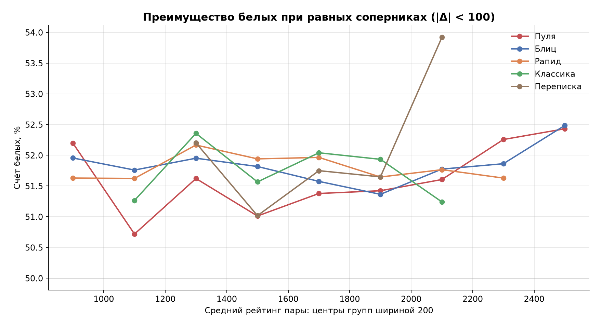

# Задача 2 — результат, дебют и разница рейтингов

## Данные и метод

Входные файлы: `games_2013-01.csv`, `games_2014-01.csv`, `games_2015-01.csv`, `games_2016-01.csv`, `games_2017-01.csv`.
Классификация контроля: base_sec + 40 × inc_sec; единые современные границы Lichess.
Выбранные контроли: Ультрапуля, Пуля, Блиц, Рапид, Классика, Переписка. Анализируются завершённые партии. Повторы game_id удалены между всеми файлами; сохранена первая завершённая запись.

Месяц определяется по `utc_date`, а не имени дампа: в месячном файле могут встречаться партии с датой соседнего месяца.

## Качество данных

| Показатель | Число |
| --- | --- |
| Прочитано строк | 17767234 |
| Исключено строк без game_id | 0 |
| Исключено незавершённых/неизвестных результатов | 1558 |
| Исключено повторов game_id (среди завершённых) | 0 |
| Уникальных завершённых партий | 17765676 |
| Расхождений метки speed и расчёта по времени | 4526783 |
| Партий без корректного контроля времени | 0 |
| Исключено вне выбранных контролей | 0 |
| Партий в анализе | 17765676 |
| Партий в анализе с неизвестной датой | 0 |
| Партий с отсутствующей/некорректной длиной | 0 |
| Партий с отсутствующим/некорректным рейтингом белых | 148 |
| Партий с отсутствующим/некорректным рейтингом чёрных | 218 |
| Партий с has_eval = 1 | 2230089 |
| Партий с рейтингами обоих игроков | 17765310 |
| Партий с разницей рейтингов за пределом анализа | 227582 |

## Определения

- Счёт белых: победа 1, ничья 0.5, поражение 0; Δ = рейтинг белых − рейтинг чёрных.
- Ожидаемый счёт по формуле Эло: E = 1 / (1 + 10^(−Δ/400)). Lichess считает рейтинги по Glicko-2, поэтому формула Эло здесь — ориентир для сравнения, а не модель сайта.
- Остаток = средний фактический счёт белых − средний ожидаемый по рейтингам. У средней партии он равен +1.43 п.п.: это преимущество первого хода, которого нет в формуле Эло.
- Эффект дебюта = остаток дебюта − остаток средней партии (в процентных пунктах). Так дебют, который чаще играют против слабых соперников, не получает «преимущество» из-за рейтингов, а преимущество белых не приписывается всем дебютам сразу. 95% интервал считает партии независимыми.
- Разница рейтингов анализируется при |Δ| < 600 (дальше — 227582 партий), корзины по 50.

## Разница рейтингов

| Δ от | Δ до | Партий | Счёт белых, % | Ожидание Эло, % | Ничьих, % |
| --- | --- | --- | --- | --- | --- |
| -600 | -550 | 50294 | 8.754 | 3.563 | 1.33 |
| -500 | -450 | 100400 | 11.453 | 6.144 | 1.781 |
| -400 | -350 | 195129 | 16.128 | 10.43 | 2.489 |
| -300 | -250 | 437756 | 22.853 | 17.144 | 3.126 |
| -200 | -150 | 888982 | 32.005 | 26.896 | 3.893 |
| -100 | -50 | 1879964 | 43.08 | 39.536 | 4.334 |
| 0 | 50 | 2744703 | 54.332 | 53.294 | 4.41 |
| 100 | 150 | 1322685 | 65.577 | 66.969 | 3.958 |
| 200 | 250 | 641948 | 75.288 | 78.279 | 3.264 |
| 300 | 350 | 296069 | 82.594 | 86.482 | 2.586 |
| 400 | 450 | 149148 | 87.756 | 91.933 | 1.869 |
| 500 | 550 | 76607 | 91.161 | 95.291 | 1.375 |

Показана каждая 2-я корзина. Корзины от 1000 партий; полная таблица — `score_by_rating_diff_all.csv`, по контролям — `score_by_rating_diff.csv`.

## Дебют

25 самых популярных семейств (от 1000 партий с рейтингами обоих игроков).

| # | Дебют | Партий | Счёт белых, % | Ожидание Эло, % | Эффект, п.п. | 95% ДИ эффекта | Ничьих, % |
| --- | --- | --- | --- | --- | --- | --- | --- |
| 1 | Sicilian Defense | 2024218 | 47.995 | 47.47 | -0.908 | -0.97…-0.84 | 3.917 |
| 2 | French Defense | 1212792 | 49.826 | 49.337 | -0.942 | -1.02…-0.86 | 3.911 |
| 3 | Queen's Pawn Game | 1057283 | 52.132 | 50.219 | 0.481 | +0.39…+0.57 | 4.159 |
| 4 | Scandinavian Defense | 799947 | 51.841 | 50.89 | -0.481 | -0.58…-0.38 | 3.893 |
| 5 | King's Pawn Game | 696488 | 51.257 | 50.224 | -0.398 | -0.51…-0.29 | 3.667 |
| 6 | Caro-Kann Defense | 586212 | 48.288 | 47.895 | -1.039 | -1.16…-0.92 | 4.235 |
| 7 | Philidor Defense | 571401 | 55.663 | 52.85 | 1.381 | +1.26…+1.50 | 4.08 |
| 8 | Italian Game | 569877 | 54.449 | 52.055 | 0.962 | +0.84…+1.08 | 3.678 |
| 9 | English Opening | 560866 | 53.772 | 51.57 | 0.77 | +0.65…+0.89 | 4.176 |
| 10 | Ruy Lopez | 449755 | 54.168 | 51.571 | 1.165 | +1.03…+1.30 | 4.344 |
| 11 | Modern Defense | 416743 | 50.673 | 49.808 | -0.567 | -0.71…-0.43 | 3.673 |
| 12 | Van't Kruijs Opening | 379303 | 46.115 | 46.204 | -1.522 | -1.67…-1.38 | 3.345 |
| 13 | Zukertort Opening | 360705 | 53.181 | 51.691 | 0.059 | -0.09…+0.20 | 3.775 |
| 14 | Hungarian Opening | 330412 | 50.931 | 49.463 | 0.036 | -0.12…+0.19 | 3.8 |
| 15 | Bishop's Opening | 322398 | 54.936 | 52.193 | 1.311 | +1.15…+1.47 | 3.656 |
| 16 | Queen's Gambit Declined | 313760 | 54.715 | 52.426 | 0.857 | +0.70…+1.02 | 4.395 |
| 17 | Scotch Game | 296135 | 54.961 | 51.607 | 1.922 | +1.76…+2.09 | 4.133 |
| 18 | Pirc Defense | 294605 | 49.729 | 48.65 | -0.353 | -0.52…-0.19 | 3.806 |
| 19 | Indian Game | 287484 | 47.236 | 46.509 | -0.705 | -0.87…-0.54 | 4.191 |
| 20 | Horwitz Defense | 267002 | 54.301 | 52.022 | 0.847 | +0.67…+1.02 | 3.609 |
| 21 | Nimzo-Larsen Attack | 241074 | 52.073 | 50.698 | -0.058 | -0.24…+0.12 | 3.582 |
| 22 | Slav Defense | 221805 | 53.605 | 51.175 | 0.998 | +0.81…+1.19 | 4.566 |
| 23 | Owen Defense | 220474 | 52.752 | 51.304 | 0.016 | -0.18…+0.21 | 3.368 |
| 24 | Nimzowitsch Defense | 207117 | 52.891 | 51.642 | -0.183 | -0.38…+0.01 | 3.513 |
| 25 | Alekhine Defense | 204375 | 49.305 | 48.231 | -0.359 | -0.56…-0.16 | 3.783 |

### Группы ECO

| Группа ECO | Партий | Счёт белых, % | Эффект, п.п. | Ничьих, % |
| --- | --- | --- | --- | --- |
| A — фланговые и прочие | 4457534 | 51.241 | -0.067 | 3.798 |
| B — полуоткрытые (кроме французской) | 4918206 | 50.081 | -0.349 | 3.837 |
| C — открытые и французская | 5699989 | 52.99 | 0.385 | 3.804 |
| D — закрытые и полузакрытые | 2262620 | 53.898 | 1.01 | 4.194 |
| E — индийские защиты | 364017 | 51.217 | -0.19 | 4.485 |
| без кода ECO | 63310 | 7.016 | -37.88 | 0.016 |

## Выводы по этой выборке

- При почти равных рейтингах (|Δ| < 50) белые набирают 51.6% очков: преимущество первого хода +1.62 п.п.
- При Δ ≥ +200 белые набирают 81.2%, при Δ < −200 — 20.9%.
- Фактический счёт в среднем отличается от ожидания Эло на 4.0 п.п.; при |Δ| ≥ 200 он ближе к 50%, чем ожидание, в 100% корзин (зависимость от рейтинга слабее формулы Эло).
- Лучший для белых с поправкой на рейтинги: Scotch Game (+1.92 п.п.); худший: Van't Kruijs Opening (-1.52 п.п.)
- У 20 из 25 дебютов 95% интервал эффекта не включает 0. Разброс эффектов: -1.52 п.п. … +1.92 п.п.; для сравнения, разница рейтингов в 100 пунктов по Эло — это +14.01 п.п.

## Ограничения

- Дебют выбирают игроки, а не случай: названия вроде «Owen Defense» или «King's Pawn Game» часто означают неудачные первые ходы, а не систему. Эффект — описательный, не причинный.
- Семейство включает ходы обеих сторон: для «защит» эффект отражает и выбор чёрных.
- Рейтинги разных контролей — разные пулы; сравнение Δ корректно внутри партии, а кривые по контролям показаны отдельно.
- Ожидание по Эло — ориентир: Lichess использует Glicko-2 с отклонением рейтинга, и у новых игроков рейтинг неточен.

## Графики

## Таблицы

- `score_by_rating_diff_all.csv`, `score_by_rating_diff.csv`: исходы по корзинам Δ (всего и по контролям).
- `score_by_opening.csv`: все семейства — исходы, ожидание Эло, остаток (`residual`), эффект (`effect`) и 95% интервалы.
- `score_by_eco.csv`: то же по буквам ECO; `baseline.csv` — остаток средней партии.
- `white_advantage_by_rating.csv`: счёт белых при |Δ| < 100 по уровню и контролю.
- `results_by_period.csv`: исходы по месяцам — проверка стабильности.
- `run_metadata.json`: входы, параметры, версии библиотек и качество данных.
