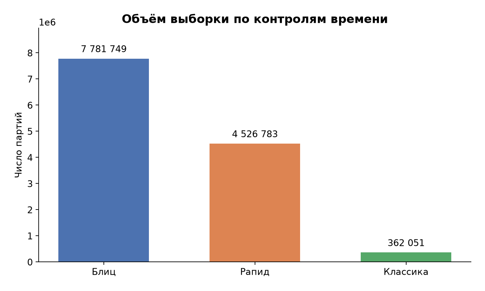
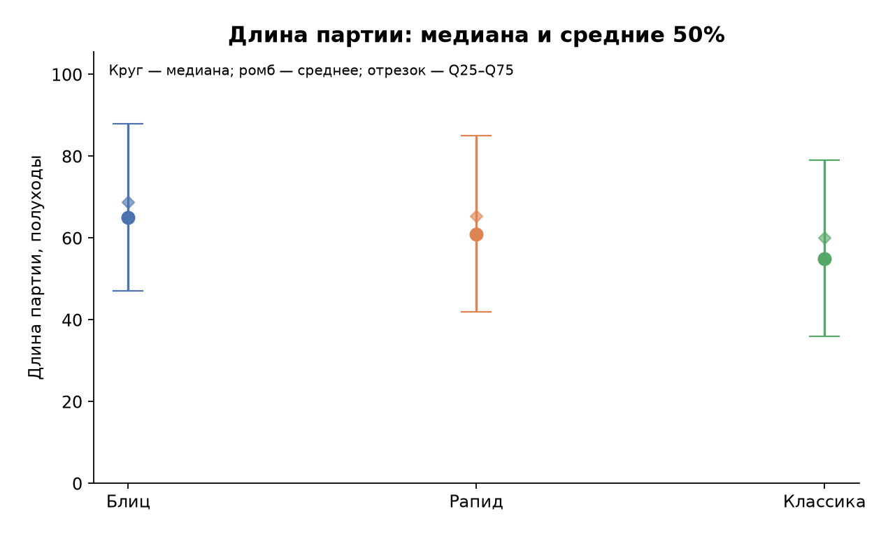
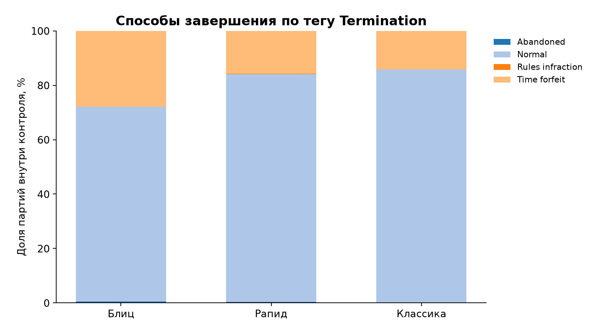

# Задача 3 — контроли времени

## Данные и метод

Входные файлы: `games_2013-01.csv`, `games_2014-01.csv`, `games_2015-01.csv`, `games_2016-01.csv`, `games_2017-01.csv`.
Классификация контроля: base_sec + 40 × inc_sec; единые современные границы Lichess.
Выбранные контроли: Блиц, Рапид, Классика. Анализируются завершённые партии. Повторы game_id удалены между всеми файлами; сохранена первая завершённая запись.

Месяц определяется по `utc_date`, а не имени дампа: в месячном файле могут встречаться партии с датой соседнего месяца.

## Качество данных

| Показатель | Число |
| --- | --- |
| Прочитано строк | 17767234 |
| Исключено строк без game_id | 0 |
| Исключено незавершённых/неизвестных результатов | 1558 |
| Исключено повторов game_id (среди завершённых) | 0 |
| Уникальных завершённых партий | 17765676 |
| Расхождений метки speed и расчёта по времени | 4526783 |
| Партий без корректного контроля времени | 0 |
| Исключено вне выбранных контролей | 5095093 |
| Партий в анализе | 12670583 |
| Партий в анализе с неизвестной датой | 0 |
| Партий с отсутствующей/некорректной длиной | 0 |
| Партий с отсутствующим/некорректным рейтингом белых | 107 |
| Партий с отсутствующим/некорректным рейтингом чёрных | 133 |
| Партий с has_eval = 1 | 1573656 |

## Перекодировка контролей времени

Контроль определяется по современным границам Lichess, а не по метке из PGN. В ранних дампах метки `rapid` нет, и партии с оценочной длительностью 8–25 минут на игрока помечены там как `classical`; после перекодировки они попадают в рапид. Метка PGN сохраняется только для переписки (`correspondence`). Ниже — все расхождения метки и расчёта в этих данных.

| Метка в PGN | Контроль по времени | Партий | % от метки |
| --- | --- | --- | --- |
| Классика | Рапид | 4526783 | 92.594 |

Полная таблица переходов — `speed_relabel.csv`. Для анализа по исходным меткам запустите скрипт с `--speed-source event`.

## Сравнение

| Контроль | Партий | Ничьих, % (95% ДИ) | Среднее, полуходы | Медиана, полуходы | Рейтинг белых | Рейтинг чёрных |
| --- | --- | --- | --- | --- | --- | --- |
| Блиц | 7781749 | 4.16 (4.15–4.18) | 68.704 | 65 | 1668.214 | 1666.588 |
| Рапид | 4526783 | 4.20 (4.18–4.22) | 65.41 | 61 | 1597.558 | 1594.016 |
| Классика | 362051 | 4.53 (4.46–4.60) | 60.082 | 55 | 1500.053 | 1496.848 |

## Выводы по этой выборке

- Больше всего партий: Блиц — 7 781 749.
- Рапид: 4 526 783 из 4 526 783 партий (100%) имели в PGN другую метку контроля (см. раздел о перекодировке).
- Доля ничьих выше в контроле «Классика» (4.53%), ниже — «Блиц» (4.16%); 95% интервалы не пересекаются. Интервалы считают партии независимыми, поэтому это ориентир, а не строгий тест.
- Блиц: медиана 65 полуходов, средние 50% партий — от 47 до 88 полуходов.
- Рапид: медиана 61 полуходов, средние 50% партий — от 42 до 85 полуходов.
- Классика: медиана 55 полуходов, средние 50% партий — от 36 до 79 полуходов.

## Ограничения и определения

- Длина — `n_plies`, число отдельных ходов сторон. Это не время в минутах. В текущем CSV нет показаний часов, только флаг `has_clock`.
- Доли результатов считаются от всех завершённых партий соответствующего контроля. Для доли ничьих приведён 95% интервал Уилсона; он не учитывает повторные партии одних игроков. Результативность — доля побед (1 − доля ничьих); `white_score` учитывает ничью как 0.5.
- `Normal` в Termination не позволяет разделить мат, сдачу и другие нормальные окончания. Пустой тег показан как `Unknown`; более подробные причины не выдумываются.
- Классы времени вычислены по единым границам, если не задан `--speed-source event`. Это полезно для старых PGN, но не превращает исторические рейтинги в рейтинги современного пула.
- Рейтинги описывают участия игроков в партиях, а не уникальных людей. Средние используют только известные значения; их знаменатели сохранены в CSV.
- Сравнение описательное: рейтинг, год, состав игроков и отбор месяцев могут влиять на результат. Статистическая значимость и причинный эффект контроля времени здесь не утверждаются.

Источник границ: [Lichess FAQ](https://lichess.org/faq#time-controls).

## Графики

## Таблицы

- `speed_summary.csv`: сводка и знаменатели метрик.
- `speed_by_month.csv`: те же средние и доли по месяцам.
- `terminations.csv`: число и доля каждого окончания внутри контроля.
- `speed_relabel.csv`: исходная метка контроля из PGN → контроль по времени.
- `length_distribution.csv`, `rating_distribution.csv`: точные частотные распределения.
- `run_metadata.json`: входы, параметры, версии библиотек и качество данных.
